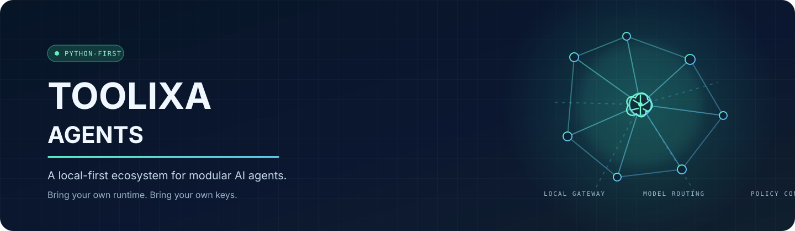
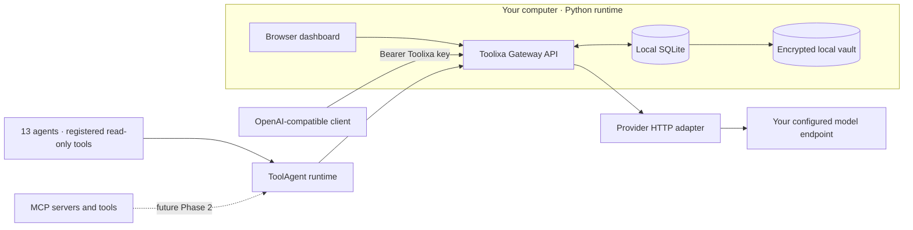

<div align="center">
  

  <p><strong>Build, connect and operate modular AI agents with your own models, tools and runtime.</strong></p>

  <p>
    <a href="https://github.com/tasnimamin38/toolixa-agents/actions/workflows/ci.yml"></a>
    <a href="https://github.com/tasnimamin38/toolixa-agents/actions/workflows/security.yml"></a>
    
    
    
    
  </p>

  <p>
    <a href="https://toolixa-agents.vercel.app/">Live Agent Directory</a> ·
    <a href="#architecture">Architecture</a> ·
    <a href="#quick-start">Quick start</a> ·
    <a href="https://github.com/tasnimamin38/toolixa-agents/blob/feature/python-local-ai-gateway/docs/gateway-guide.md">Gateway guide</a> ·
    <a href="#roadmap">Roadmap</a>
  </p>
</div>

---

## Project at a glance

Toolixa Agents is evolving from a static agent directory and Python starter SDK into a **local-first AI gateway and agent runtime**. You bring the provider accounts, API credentials and machine or server that runs the agents. Toolixa provides the modular contracts and control layers.

| Principle | What it means |
|---|---|
| **BYOK** | Use API keys and accounts from providers you choose |
| **BYOR** | Run the gateway and agents in an environment you control |
| **Python-first** | Agent logic, gateway, orchestration and policy are Python |
| **Modular** | Providers, tools, memory and agents are separate integration surfaces |
| **Deny by default** | Declared capabilities do not automatically grant permissions |

## Current project status

<div align="center">
  <h3>EXPERIMENTAL MODEL-DRIVEN AGENT ALPHA · REVIEW PENDING</h3>
  <p><strong>Bounded tool-calling runtime · 13 agents · fixed engineering workflow · independent security review pending</strong></p>
</div>

**Important release distinction:** the original six-agent foundation and static directory are on `main`. The Local AI Gateway, shared model-driven tool runtime and six advanced specialists are in Draft [Pull Request #1](https://github.com/tasnimamin38/toolixa-agents/pull/1), branch `feature/python-local-ai-gateway`. The feature branch now includes a fixed three-stage Engineering Workflow Orchestrator in addition to the six specialist agents. The workflow is being validated on this branch; it has not been merged into `main` or deployed as a hosted backend. Independent security review remains pending.

| Area | Current state |
|---|---|
| Static Agent Directory | Deployed on Vercel |
| Python core contracts and safety primitives | Experimental foundation on `main` |
| Six bounded starter agents | Experimental on `main` |
| Local browser-based AI Gateway | Draft PR #1 |
| Shared model-driven tool-calling runtime | Draft PR #1 |
| Six advanced model-driven specialists | Draft PR #1 |
| Fixed Engineering Workflow Orchestrator | Draft PR #1 |
| Native vendor protocols and MCP tool execution | Planned — next phase |
| Write/execute sandbox and autonomous multi-agent delegation | Planned — later beta phases |
| Production hardening and hosted multi-user SaaS | Not started — later phases |

This is **not production-ready software**. The gateway is a single-user, loopback-only local alpha. Do not expose it to the public internet or use it as an unreviewed executor for untrusted code.

## What is included

<table>
  <tr>
    <td width="33%" valign="top">
      <h3>01 · Agent SDK</h3>
      Shared Python contracts, request/result models, execution budgets, provider and tool interfaces, policy checks and memory abstractions.
    </td>
    <td width="33%" valign="top">
      <h3>02 · Local AI Gateway</h3>
      Browser dashboard, encrypted local provider credentials, model discovery, chat playground and a compatible local API.
    </td>
    <td width="33%" valign="top">
      <h3>03 · Safety primitives</h3>
      Deny-by-default permissions, one-time approvals, secret redaction and a disabled-by-default process executor.
    </td>
  </tr>
  <tr>
    <td valign="top">
      <h3>04 · Thirteen agents</h3>
      Six bounded starters, six model-driven specialists and one fixed multi-agent engineering workflow.
    </td>
    <td valign="top">
      <h3>05 · Provider flexibility</h3>
      Connect any trusted upstream that implements the supported OpenAI Chat Completions-compatible API surface.
    </td>
    <td valign="top">
      <h3>06 · Quality gates</h3>
      Automated tests, Ruff, compile checks, catalog validation and dependency auditing in GitHub Actions.
    </td>
  </tr>
</table>

## Agent directory

| Agent | Current capability | Important boundary |
|---|---|---|
| **Dev Copilot** | Read-only Python workspace inspection and AST analysis | Does not execute or modify code |
| **Aegis Security** | Passive local secret-pattern and risky-code checks | Not an active scanner or penetration tester |
| **Task Orchestrator** | Deterministic task dependency ordering | Does not launch autonomous sub-agents |
| **RAG Chatbot** | Local Markdown/text retrieval with source line ranges | Lexical retrieval, not vector/embedding search |
| **Content Maestro** | Structured editorial brief and research checklist | Does not perform live web research |
| **Web Scraper** | Parse supplied local HTML into metadata, headings and links | No remote crawling or arbitrary HTTP fetching |

### Advanced specialist agents (Draft PR #1)

| Agent | Real work it performs | Boundary |
|---|---|---|
| **Software Engineer** | Maps source, inspects Python AST/Git diff, proposes a refactor plan and patch text | Does not apply edits or execute code |
| **Code Reviewer** | Reviews changes and related source; prioritizes actionable findings with file evidence | Does not fix code or run tests |
| **Test Engineer** | Maps modules to tests and designs pytest cases, fixtures and assertions | Does not execute tests or write test files |
| **Data Analyst** | Profiles local CSV data: missingness, duplicates and descriptive statistics | No raw-row upload or data mutation |
| **API Architect** | Inspects OpenAPI 3.x JSON and maps endpoints/schemas | No remote endpoint calls; no YAML yet |
| **Research Analyst** | Searches local docs and synthesizes source/line-cited evidence | No public internet browsing |
| **Engineering Workflow Orchestrator** | Runs Software Engineer → Code Reviewer → Test Engineer with shared handoffs and budget | Fixed order; read-only; no dynamic spawning |

Browse the [live directory](https://toolixa-agents.vercel.app/) or inspect each agent under `agents/`. The advanced agents and Engineering Workflow Orchestrator are included in the Draft branch catalogue, not yet in the live Vercel site.

## Architecture

The diagram shows the Gateway and model-driven specialist runtime on Draft PR #1. The six-agent foundation is on `main`; MCP, browser automation and isolated write/execute tools remain future integrations.



### Local gateway request flow

1. Start the gateway from PowerShell.
2. Open the local dashboard in your browser.
3. Add a provider name, API base URL and provider credential.
4. Test the connection and discover available models.
5. Use the playground or create a Toolixa API key.
6. Connect a compatible client to the local `/v1` endpoint.

## Provider compatibility

The Local AI Gateway adapter on Draft PR #1 supports the **OpenAI Chat Completions-compatible** model listing, JSON chat and streaming chat surface. This is a compatibility boundary, not a claim that every vendor-native API is already implemented.

| Provider or runtime | Connection approach |
|---|---|
| OpenRouter | OpenAI-compatible API endpoint |
| Ollama | Its OpenAI-compatible local endpoint |
| LM Studio | Its local OpenAI-compatible server |
| vLLM | Its OpenAI-compatible server |
| Other gateways and hosted/local models | Any trusted endpoint implementing the supported routes |
| Native Anthropic / Gemini APIs | Planned dedicated adapters |
| MCP servers | Planned Python MCP client and permission-aware tool bridge |

See [Provider and Gateway setup](https://github.com/tasnimamin38/toolixa-agents/blob/feature/python-local-ai-gateway/docs/gateway-guide.md) for endpoint requirements and limitations.

## Quick start

### 1. Install the core SDK

Requirements: Python 3.11+ and Git.

```powershell
git clone https://github.com/tasnimamin38/toolixa-agents.git
cd toolixa-agents

python -m venv .venv
.\.venv\Scripts\Activate.ps1

python -m pip install --upgrade pip
python -m pip install -e ./core
```

### 2. Run a bounded starter agent

For example, the read-only Dev Copilot:

```powershell
cd agents/01-dev-copilot
python main.py --workspace C:\path\to\your\project
```

Each agent has its own README, manifest and dependency file. Review its exact scope before running it.

### 3. Run the Local AI Gateway

The gateway and specialist runtime are currently on [Draft PR #1](https://github.com/tasnimamin38/toolixa-agents/pull/1), not on the default `main` branch yet. From the repository you already cloned in step 1, switch to the feature branch and install both optional extras:

```powershell
git fetch origin feature/python-local-ai-gateway
git switch feature/python-local-ai-gateway

python -m pip install --upgrade pip
python -m pip install -e ".\core[gateway,runtime]"
python -m toolixa_core.gateway
```

The terminal prints a one-time dashboard password. Open `http://127.0.0.1:20128` in your browser. The compatible API base is `http://127.0.0.1:20128/v1`.

The gateway binds to loopback only. **Do not port-forward, tunnel or reverse-proxy this experimental service to the public internet.**

### 4. Run an advanced model-driven specialist

Install the optional runtime extra and set the Toolixa Gateway key and chosen namespaced model in PowerShell:

```powershell
python -m pip install -e ".\\core[runtime]"

$env:TOOLIXA_GATEWAY_URL = "http://127.0.0.1:20128/v1"
$env:TOOLIXA_API_KEY = "YOUR_TOOLIXA_GATEWAY_KEY"
$env:TOOLIXA_MODEL = "provider-id/model-id"

python agents/07-software-engineer/main.py "Map this codebase and propose a safe refactor" --workspace C:\\path\\to\\repo --grant workspace.read
```

Choose a model that supports function/tool calling. The API key is a Toolixa Gateway client key, not the upstream provider key. The Gateway keeps the upstream key in its encrypted local vault. See the [Advanced Specialist Agents guide](https://github.com/tasnimamin38/toolixa-agents/blob/feature/python-local-ai-gateway/docs/advanced-agents-guide.md).

## Security and credential handling

- Provider API keys are encrypted in the local SQLite store. The vault key is kept separately in the user's application-data directory.
- Toolixa API keys are displayed once and stored as hashes.
- The dashboard is protected by a local password and a signed session cookie.
- The local gateway rejects non-loopback plaintext HTTP endpoints and does not follow provider redirects.
- The specialist runtime validates tool schemas, enforces explicit workspace.read grants and applies request step/tool/wall-time budgets.
- Advanced agents are read-only: no source writes, arbitrary shell, test execution, browser automation, internet fetches or MCP tool invocation.
- The only multi-agent coordination is the fixed Engineer → Reviewer → Test Engineer workflow; it shares one budget and cannot spawn or reorder agents.
- No real provider key or paid model request is required for installation or automated tests.
- The gateway has not yet completed an independent penetration test or full production web-security review.
- A configured provider receives the prompts and conversation data sent to it. Review that provider's privacy, retention and billing terms.

### 5. Run the Engineering Workflow Orchestrator

This runs the existing three engineering specialists in order. Set the Gateway environment variables from step 4 first:

```powershell
python agents/13-engineering-workflow/main.py "Review the payments service and propose the safest reliability improvement" --workspace C:\\path\\to\\repo --grant workspace.read
```

The final JSON contains the Software Engineer analysis, independent Code Reviewer findings, Test Engineer plan and one aggregate budget report. Every stage must use a real read-only tool. The workflow stops on stage failure or exhausted budget; it does not change source files or run tests. See the [Engineering Workflow guide](docs/engineering-workflow-guide.md).

Read the [Security Model](docs/security-model.md) before connecting credentials or enabling any additional capabilities.

## Roadmap

| Phase | Objective | Status |
|---|---|---|
| **0 · Foundation** | Python core, six bounded starter agents, static directory, CI | <strong>Completed</strong> |
| **1 · Gateway + Specialist Runtime** | Encrypted BYOK Gateway, model tool-call runtime, six advanced specialists and fixed engineering workflow | <strong>Draft PR #1; validation and security review pending</strong> |
| **2 · Native AI + MCP** | Native provider adapters, MCP registration/discovery and permission-gated tool calls | Planned |
| **3 · Advanced Agent Runtime** | Multi-agent delegation, persistent memory, browser integration and reviewed patch/execute sandbox | Planned |
| **4 · Production Gate** | Threat-model review, penetration testing, rate limits, audit, egress and operational controls | Not started |
| **5 · Hosted Service** | Optional multi-user SaaS, tenant isolation, remote secrets, quotas and billing | Not started |

### When does Experimental end?

Experimental status does not end just because the dashboard or API exists. The project moves out of experimental only after the agents perform their documented jobs reliably, provider and MCP integrations pass adversarial testing, tool execution is isolated, credentials and tenants are protected, and an independent security review plus release acceptance tests are complete.

Until those conditions are met, the honest project status remains **Experimental**.

## Development and verification

For the current `main` foundation, install the core SDK and development tools:

```powershell
python -m pip install -e ./core
python -m pip install -r agents/06-web-scraper/requirements.txt
python -m pip install "pytest>=9.0.3,<10" "ruff>=0.8,<1"

python -m compileall -q core/src agents scripts tests
ruff check core/src agents scripts tests
ruff format --check core/src agents scripts tests
python scripts/build_catalog.py --check
python -m pytest -q
```

To run the Local AI Gateway and model-driven specialists, first check out the feature branch using the instructions above, then install `python -m pip install -e "./core[gateway,runtime]"`. Gateway and workflow contract tests use mocked upstream responses and do not make paid provider calls.

## Documentation

| Document | What it covers |
|---|---|
| [Architecture](docs/architecture.md) | Components, boundaries and data flow |
| [Security Model](docs/security-model.md) | Permissions, secrets, execution and threats |
| [Gateway Guide](https://github.com/tasnimamin38/toolixa-agents/blob/feature/python-local-ai-gateway/docs/gateway-guide.md) | Local dashboard, providers and compatible API (Draft PR #1) |
| [BYOR / BYOK Guide](docs/byor-guide.md) | Runtime and credentials ownership |
| [Installation](docs/installation.md) | Install and launch |
| [Development](docs/development.md) | Tests, lint, CI and contribution workflow |
| [Advanced Specialist Agents](https://github.com/tasnimamin38/toolixa-agents/blob/feature/python-local-ai-gateway/docs/advanced-agents-guide.md) | Model setup, tool capabilities, PowerShell usage and limits |
| [Engineering Workflow](docs/engineering-workflow-guide.md) | Fixed three-stage handoffs, shared budget, CLI and security boundaries |
| [Workflow Design](docs/specs/2026-11-28-multi-agent-engineering-workflow-design.md) | Workflow contract, handoffs, trust and release limits |
| [Workflow Implementation Plan](docs/plans/2026-11-28-multi-agent-engineering-workflow.md) | Test-first tasks and release gates |
| [Advanced Runtime Design](https://github.com/tasnimamin38/toolixa-agents/blob/feature/python-local-ai-gateway/docs/specs/2026-11-27-advanced-agent-runtime-design.md) | Shared runtime, tool policies and test boundaries |
| [Advanced Runtime Plan](https://github.com/tasnimamin38/toolixa-agents/blob/feature/python-local-ai-gateway/docs/plans/2026-11-27-advanced-agent-runtime.md) | Implementation tasks and release gates |
| [Foundation Plan](docs/plans/2026-11-27-toolixa-agents-implementation.md) | Original six-agent foundation plan |

## License

No license has been selected. Public visibility on GitHub does not grant permission to reuse, modify or redistribute this project. Do not assume an open-source license applies.

---

<div align="center">
  <strong>Toolixa Agents</strong><br/>
  <sub>Local-first · Python-first · Your models · Your runtime · Your control</sub><br/><br/>
  <a href="https://github.com/tasnimamin38/toolixa-agents">Repository</a> ·
  <a href="https://toolixa-agents.vercel.app/">Agent Directory</a> ·
  <a href="https://github.com/tasnimamin38/toolixa-agents/pulls">Pull requests</a>
</div>